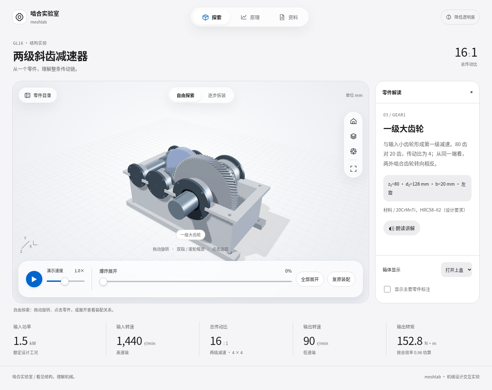

# MeshLab · 齿轮研习室

两级斜齿减速器的三维交互教学网站，当前版本为 Apple Design 风格第二版。原生 HTML/CSS/JavaScript + Three.js，静态部署即可运行，无需 Node 构建。

## 功能

- 49 个可选择 CAD 零件、中文说明与按钮朗读。
- 爆炸展开、复原、七步拆装与按传动比例运行的演示动画。
- 手机、平板、桌面适配，系统明暗模式、降低透明度与减少动态效果适配。
- STEP 装配和零件、PDF 图纸和说明书、BOM、JSON 参数与完整工程包。

设计参数：输入 1.5 kW / 1440 r/min，总传动比 16（4 × 4），输出 90 r/min；按总效率 0.96 估算输出转矩 152.8 N·m。

## 本地运行

在本文件所在目录运行：

```sh
python -m http.server 8080 --directory dist
```

浏览器打开 http://localhost:8080 。请通过 HTTP 服务打开，不要直接双击 HTML；模型使用 fetch 和 ES modules。网页已包含 Three.js 和模型资源，语音质量取决于设备中文语音支持。

## 文件结构

- `dist/`：可直接部署的网站，`index.html`、`app.js`、`apple.css`、`apple.js` 是网页源代码。
- `dist/assets/`：Three.js、OrbitControls、CAD 网格和模型参数。
- `dist/downloads/`：STEP、PDF、BOM 与工程资料包。
- `dist/previews/`：桌面、手机和深色版实际浏览器截图。
- `scripts/`：参数化 CAD、文档生成、工程验证及浏览器检查脚本。
- `docs/`：本版设计审查和已执行的界面检查记录。

## 重新生成工程资料（可选）

建议使用 Python 3.12 独立虚拟环境。浏览网页不需要安装这些依赖。

```sh
pip install -r requirements-engineering.txt
python scripts/build_model.py
python scripts/build_documents.py
python scripts/validate_engineering.py
```

这些命令会重新生成并覆盖 `dist/assets/` 和 `dist/downloads/` 中相关文件。原始实体单位为 mm，轴线沿 Z；STEP 不包含原生 CAD 特征树及装配约束。

## 浏览器验证（可选）

先启动上述本地服务，再在另一终端运行：

```sh
pip install -r requirements-test.txt
python -m playwright install chromium
python scripts/verify_browser.py
```

默认访问 http://127.0.0.1:8080/ ，可用 `MESHLAB_BASE_URL` 修改，`CHROMIUM_PATH` 可指定浏览器。结果写入 `test-results/`。本版检查使用 Chromium；尚未在实体 iPhone 上验证。

## 部署

上传 `dist/` 内全部文件到静态托管平台即可。若作为已有仓库的 `meshlab/` 子目录连接 Netlify，将 Base directory 设置为 `meshlab`，Publish directory 设置为 `dist`，无需构建命令。本项目不包含自动发布工作流。

## 设计预览



[手机预览](dist/previews/mobile.png) · [深色预览](dist/previews/desktop-dark.png)

## 工程与依赖说明

GL16 为参考工业产品公开资料的独立本科课程设计，并非厂家内部图纸复原或投产认证。载荷、材料与许用值假设见设计说明书；投产前需进一步完成工艺、公差链与标准强度验证。

使用的 Apple Design Skill 为社区设计参考；网页玻璃效果由 CSS 实现。Third-party Three.js / OrbitControls 使用 MIT 许可，原文件保留版权声明。资料来源链接见网页工程资料页和 `scripts/manufacturer-reference.md`。
