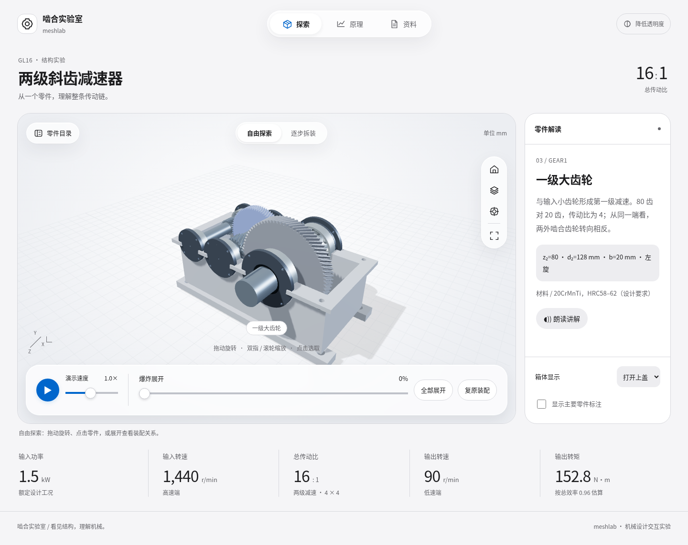

# meshlab · 啮合实验室

> 2026-10-28 更新：按网站维护者要求，暂时关闭邮箱验证。注册或邮箱密码登录后即可聊天，不自动发送验证邮件；每账号每日 2 元预算不变。恢复时将 wrangler.jsonc 的 REQUIRE_EMAIL_VERIFICATION 改为 "true" 并重新部署 Worker，前端会自动采用云端策略。以下涉及强制验证的步骤仅在重新开启后适用。

两级斜齿减速器的三维交互教学网站，当前版本为 Apple Design 风格第二版。原生 HTML/CSS/JavaScript + Three.js，静态部署即可运行，无需 Node 构建。

## 功能

- 49 个可选择 CAD 零件、中文说明与按钮朗读。
- 爆炸展开、复原、七步拆装与按传动比例运行的演示动画。
- 手机、平板、桌面适配，系统明暗模式、降低透明度与减少动态效果适配。
- STEP 装配和零件、PDF 图纸和说明书、BOM、JSON 参数与完整工程包。
- DeepSeek 聊天：邮箱注册、验证与登录，每账号每日 2 元预算；流式回答、连续追问、当前零件上下文，以及停止、重试和新对话。

设计参数：输入 1.5 kW / 1440 r/min，总传动比 16（4 × 4），输出 90 r/min；按总效率 0.96 估算输出转矩 152.8 N·m。

## 摩擦轮实验

入口为 [friction.html](dist/friction.html)，复用现有减速器的公共 UI，参数放在模型下方。可调整主动/从动轮直径、轮宽、输入转速、压紧力、摩擦系数和负载转矩。几何尺寸变化会重建两轮并保持外接相切；接触载荷变化只更新计算。

点击播放观察相反转向，使用爆炸、复原、逐步拆装和零件目录检查结构。原理页说明速比与摩擦容量，AI 提问会附带本次问题对应的参数和选中零件。1× 为实际输入转速的 20% 慢放；超载只提示打滑风险，不计算实际滑移速度。详细公式与范围见 [friction/DESIGN.md](dist/friction/DESIGN.md)。

## 单级直齿圆柱齿轮实验

入口为 [spur.html](dist/spur.html)，公共视图、控制栏、拆装和 AI 与既有实验一致，参数位于模型下方。主动齿数、从动齿数、模数和齿宽控制几何；输入转速、输入转矩与效率控制运动和计算。预设提供 20/40、30/30、40/20 齿组合。

传动比定义为 `i=z₂/z₁=n₁/|n₂|`，外啮合从动轮反向；非零转速时按 `T₂=T₁iη`、`P₂=P₁η` 计算稳态输出。零转速时功率为 0，不推算静态输出转矩。1× 演示为实际输入转速的 20% 慢放；轮齿几何、假设和参考资料见 [spur/DESIGN.md](dist/spur/DESIGN.md)。

## 本地运行

要使用 AI 聊天，在本目录运行 `node --env-file-if-exists=.env server/local.mjs`，需要 Node.js 22+。本地预览代理到云端，邮箱登录及每日预算与正式网站共享，无需本机 DeepSeek 密钥。详细步骤见 [AI 接入说明](docs/AI-SETUP.md)，后续开发见 [分步计划](docs/AI-ROADMAP.md)。

仅浏览三维网页时也可使用以下静态服务（不提供聊天 API）：

在本文件所在目录运行：

```sh
python -m http.server 8080 --directory dist
```

浏览器打开 http://localhost:8080 。请通过 HTTP 服务打开，不要直接双击 HTML；模型使用 fetch 和 ES modules。网页已包含 Three.js 和模型资源，语音质量取决于设备中文语音支持。

## 文件结构

- `dist/`：可直接部署的网站，`index.html`、`app.js`、`apple.css`、`apple.js` 是网页源代码。
- `dist/assets/`：Three.js、OrbitControls、CAD 网格和模型参数。
- `dist/friction/`：摩擦轮参数、计算、三维模型、交互和 AI 上下文。
- `dist/spur/`：单级直齿轮参数、计算、三维模型、交互和 AI 上下文。
- `dist/downloads/`：STEP、PDF、BOM 与工程资料包。
- `dist/previews/`：桌面、手机和深色版实际浏览器截图。
- `scripts/`：参数化 CAD、文档生成、工程验证及浏览器检查脚本。
- `docs/`：本版设计审查和已执行的界面检查记录。

## 重新生成工程资料（可选）

建议使用 Python 3.12 独立虚拟环境。浏览网页不需要安装这些依赖。

```sh
pip install -r requirements-engineering.txt
python scripts/build_model.py
python scripts/build_documents.py
python scripts/validate_engineering.py
```

这些命令会重新生成并覆盖 `dist/assets/` 和 `dist/downloads/` 中相关文件。原始实体单位为 mm，轴线沿 Z；STEP 不包含原生 CAD 特征树及装配约束。

## 浏览器验证（可选）

先启动上述本地服务，再在另一终端运行：

```sh
pip install -r requirements-test.txt
python -m playwright install chromium
python scripts/verify_browser.py
```

默认访问 http://127.0.0.1:8080/ ，可用 `MESHLAB_BASE_URL` 修改，`CHROMIUM_PATH` 可指定浏览器。结果写入 `test-results/`。本版检查使用 Chromium；尚未在实体 iPhone 上验证。

## 部署

网页使用 [GitHub Pages](https://slack-zh.github.io/meshlab/)，仓库根目录 `.github/workflows/pages.yml` 在 main 更新时发布 `meshlab/dist/`，无需构建命令。聊天 API 由 Cloudflare Worker 提供，地址及公开 Firebase 配置在 `dist/chat-config.json`，使用时需要邮箱登录并完成验证。每日预算由云端 SQLite 持久记账，北京时间零点重置。静态托管不会运行 `server/`。后端部署与 Secret 管理见 [AI 接入说明](docs/AI-SETUP.md)。

## 设计预览



[手机预览](dist/previews/mobile.png) · [深色预览](dist/previews/desktop-dark.png)

## 工程与依赖说明

GL16 为参考工业产品公开资料的独立本科课程设计，并非厂家内部图纸复原或投产认证。载荷、材料与许用值假设见设计说明书；投产前需进一步完成工艺、公差链与标准强度验证。

使用的 Apple Design Skill 为社区设计参考；网页玻璃效果由 CSS 实现。Third-party Three.js / OrbitControls 使用 MIT 许可，原文件保留版权声明。资料来源链接见网页工程资料页和 `scripts/manufacturer-reference.md`。
