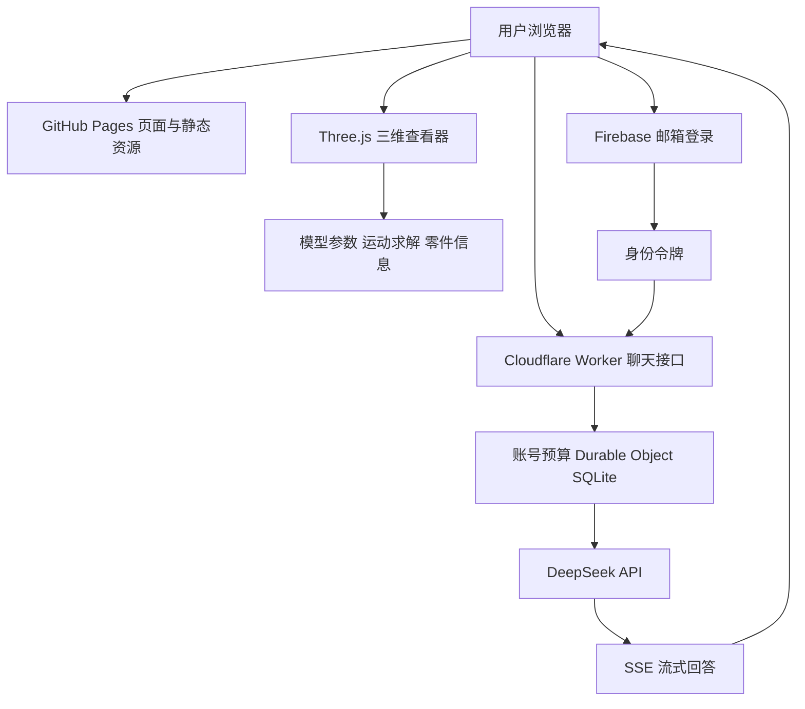

# 啮合实验室 meshlab 项目说明文档

编制日期：2026 年 11 月 19 日  
项目仓库：[Slack-ZH/meshlab](https://github.com/Slack-ZH/meshlab)  
在线入口：[啮合实验室](https://slack-zh.github.io/meshlab/)  
版本依据：`main` 分支提交 [`9351cbd`](https://github.com/Slack-ZH/meshlab/commit/9351cbd214ce52d1252aeca9d52c38e7b6f239a5)，提交日期为 2026 年 11 月 18 日。

## 一 项目概述

啮合实验室 meshlab 是面向机械课程学习、课程设计和教学展示的 Web 三维交互平台。项目将机械结构、装配拆解、运动演示、参数计算、工程资料和 AI 问答组织在同一学习环境中，让学习者从观察零件出发，逐步理解机构的组成、运动关系与工作原理。

项目以 GL16 两级斜齿减速器为起点，现已扩展为 **44 项机械实验**，包括 9 个独立实验和 35 项共用查看器的参数化机构实验。内容覆盖齿轮、带链、摩擦传动、联轴器、离合器、往复机构，以及汽车、机床、机器人和能源装备中的典型机械系统。

用户通过支持 WebGL 的浏览器即可进入实验，无需安装 CAD 软件。三维交互与确定性计算主要在浏览器中完成，AI 问答通过独立云端服务提供；GL16 配套 STEP 模型、图纸、BOM 和设计说明书，可进一步用于课程学习与结构分析。

## 二 项目背景与使用场景

机械课程需要学习者同时理解空间结构、运动规律和数值关系。二维图纸侧重尺寸与表达规则，初学者还需要建立零件之间的空间联系；固定视角的视频能够呈现过程，但难以围绕一个局部反复观察和改变条件。

啮合实验室通过可操作的三维模型，把“观察结构—改变参数—比较结果—查阅原理—继续提问”连成一条学习路径。学习者可以改变齿数比较增速与减速，切换惰轮观察转向，调整丝杠导程查看进给变化，也可以拆开复杂机构追踪动力传递路线。

| 使用对象 | 典型场景 | 平台提供的支持 |
| --- | --- | --- |
| 机械及相关专业学生 | 课前预习、课后复习、课程设计 | 三维结构、运动关系、参数结果和工程资料 |
| 授课教师 | 课堂讲解、机构对比、问题引导 | 可旋转模型、慢放动画、逐步拆装和不同工况对照 |
| 工程入门学习者 | 认识零件与常见传动系统 | 中文零件说明、原理介绍和结合当前模型的问答 |
| 项目展示人员 | 课程汇报、作品演示 | 浏览器入口、统一交互方式和可追溯的资料 |

## 三 实验内容与功能范围

### 结构目录

首页由机械展台、结构目录和使用指南组成。结构目录支持名称和别名搜索，并按五类组织实验；例如可用“机械臂”查找工业机器人腕部传动。当前分类数量如下。

| 分类 | 数量 | 代表内容 |
| --- | ---: | --- |
| 齿轮与减变速 | 14 | GL16、直齿轮、惰轮、行星传动、CVT、谐波、RV、各类变速箱 |
| 带链与摩擦传动 | 6 | 摩擦轮、自行车链传动、平带、同步带、链条输送机、自行车后拨 |
| 轴连接与离合 | 7 | 单万向节、双万向节、球笼万向节、奥尔德姆联轴器及三类离合器 |
| 直线与往复机构 | 7 | 台虎钳、滚珠丝杠、雨刮、转向齿条、配气机构、共轭凸轮、分度凸轮 |
| 动力与装备系统 | 10 | 汽轮机、液力变矩器、混动、四驱、PTO、数控进给、机器人腕部等 |
| 合计 | **44** | 9 个独立实验与 35 项扩展机构 |

数量对应当前首页实验入口和[首页分类配置](https://github.com/Slack-ZH/meshlab/blob/9351cbd214ce52d1252aeca9d52c38e7b6f239a5/meshlab/scripts/homepage-categories.json)。

### 九个独立实验

| 实验 | 页面入口 | 核心学习内容 |
| --- | --- | --- |
| GL16 两级斜齿减速器 | `lab.html` | 49 个可选零件、两级动力传递、七步拆装、固定 CAD 结构和配套工程资料 |
| 参数化汽轮机 | `turbine.html` | 汽缸与动静叶结构、级数和叶片几何、蒸汽工况及功率估算 |
| 自行车链传动 | `bicycle.html` | 牙盘与后链轮齿数、踏频、闭合链条、后轮转速和理论车速 |
| 摩擦轮传动 | `friction.html` | 轮径与速比、接触相切、压紧力、摩擦容量和打滑风险 |
| 单级直齿圆柱齿轮 | `spur.html` | 齿数、模数、中心距、外啮合转向、输出转矩和功率 |
| 带惰轮齿轮列 | `idler.html` | 两轮和三轮模式、惰轮对转向的作用、首尾速比和啮合效率 |
| 交叉平带传动 | `belt.html` | 交叉与开口布置、输出转向、包角、带速和理论带长 |
| 同步带传动 | `timing.html` | 齿数速比、固定 5 mm 节距、整数带齿数与实际中心距匹配 |
| 台虎钳丝杠螺母 | `vice.html` | 导程、旋转与直线进给、开口变化、反向运动和行程端点停止 |

### 三十五项扩展机构

扩展机构使用 `catalog.html?model=<id>` 进入，每个机构独立定义参数、零件、运动关系、原理说明和适用范围。代码分为三个模型组。

| 模型组 | 数量 | 包含机构 |
| --- | ---: | --- |
| 基础运动与连接机构 | 11 | 单十字轴万向节、双万向节传动轴、链条输送机、滚珠丝杠、摩擦片离合器、滚柱式单向离合器、离心离合器、奥尔德姆联轴器、自行车后拨、汽车雨刮、汽车转向齿轮齿条 |
| 机械传动机构 | 12 | 配气机构、简单行星传动、三速内变速花鼓、手动变速箱、同步器、CVT、球笼等速万向节、共轭凸轮、分度凸轮、摆线针轮、谐波减速器、包络蜗杆 |
| 装备与动力系统 | 12 | RV 减速器、DCT、行星 AT、液力变矩器、混动功率分流、四驱分动箱、拖拉机 PTO、多轴数控进给、机器人腕部、钟表与擒纵、双转子直升机主减速器、风电增速箱 |

完整机构名称、ID 和实验能力见[扩展机构目录](https://github.com/Slack-ZH/meshlab/blob/9351cbd214ce52d1252aeca9d52c38e7b6f239a5/meshlab/dist/catalog/README.md)。

### 通用交互能力

用户可以旋转和缩放模型，选择零件查看说明，利用爆炸展开、复原和逐步拆装观察装配关系，通过播放和速度控制追踪运动。原理与资料区域提供公式、假设和来源；具体模型还提供箱体隐藏、透明显示或传动部件筛选等观察方式。

参数功能区分几何、运动和计算三种作用。例如齿数与模数改变轮齿和中心距，输入转速改变运动速度，给定效率改变功率与转矩结果。扩展机构仅修改输入转速时保留运动相位，其他参数变化先验证，再暂停并重建；非法组合会提示原因并保留上一组有效模型。

扩展目录及链带等实验的 1× 动画使用工况转速的 20% 慢放，计算仍采用设置工况。暂停只停止画面运动，不把理论工况自动改为零。GL16 和汽轮机各自使用其页面定义的演示速度逻辑。

## 四 典型案例与学习流程

### GL16 两级斜齿减速器

GL16 是连接三维结构、运动原理与工程资料的完整案例。模型包含箱体、输入轴、中间轴、输出轴、齿轮、轴承、端盖及紧固件等 49 个可选零件，并提供中文说明、按钮朗读和七步拆装。

| 设计参数 | 数值 |
| --- | ---: |
| 输入功率 | 1.5 kW |
| 输入转速 | 1440 r/min |
| 两级传动比 | 4 × 4 |
| 总传动比 | 16 |
| 输出转速 | 90 r/min |
| 估算总效率 | 0.96 |
| 估算输出转矩 | 152.8 N·m |

三轴的转速方向与比例为 `1 : −1/4 : 1/16`。两次外啮合使输出轴与输入轴同向；输出转矩按给定功率、速比和效率估算。这些数值属于固定课程设计参考，页面调节输入转速会更新计算与演示速度，工程尺寸保持固定。

GL16 下载资料包括 STEP 装配与主要零件、PDF 图纸、设计说明书、零件清单 CSV、设计参数 JSON 和完整工程包。STEP 提供几何实体，不包含原生 CAD 特征树与装配约束。

### 建议体验流程

1. 打开首页，搜索或选择一个机构，进入对应实验。
2. 旋转模型并选择零件，建立整体结构与局部部件之间的联系。
3. 播放运动，观察输入、传动路径和输出的关系。
4. 一次改变一个参数，结合结果区比较变化；例如改变直齿轮齿数观察速比，改变模数观察尺寸。
5. 展开模型或使用逐步拆装，观察零件之间的装配关系。
6. 阅读原理和适用范围，选中零件向 AI 提问；GL16 案例可继续下载图纸与设计资料。

## 五 AI 教学助手

AI 助手使用 DeepSeek 提供中文流式问答，支持连续追问、停止生成、重试和新建对话。系统结合提问时的实验类型、有效参数、所选零件及相关运动状态组织上下文，使问题能够围绕当前观察对象展开。

例如，在万向节实验中改变轴间夹角后，可以询问“输出转速为什么不均匀”；在同步带实验中改变目标中心距后，可以询问“为什么实际中心距与输入值存在差异”。AI 负责解释页面中的模型与计算，当前仅提供文字回答，自然语言执行三维操作仍属于后续开发方向。

账号使用 Firebase 邮箱密码认证。当前仓库配置 `REQUIRE_EMAIL_VERIFICATION=false`，即注册或登录后可使用聊天；客户端会根据后端健康检查返回的策略决定是否要求邮箱验证。

每个账号设置每日 2 元应用预算，按北京时间零点重置。后端先预留单次请求的保守费用，再依据返回用量结算，预算存储在 Cloudflare Durable Object 的 SQLite 中。该额度属于每账号的应用控制策略，所有账号产生的 API 费用仍由服务维护者承担。

对话保存在当前页面内存中，刷新、退出或切换账号会清空；扩展目录切换机构时重新开始对应机构的会话。前端通过 `/api/health` 检查后端支持的模型上下文，目录原生上下文以实际部署服务声明的能力为准。

实现入口见[聊天前端](https://github.com/Slack-ZH/meshlab/blob/9351cbd214ce52d1252aeca9d52c38e7b6f239a5/meshlab/dist/chat.js)、[Worker 接口](https://github.com/Slack-ZH/meshlab/blob/9351cbd214ce52d1252aeca9d52c38e7b6f239a5/meshlab/server/worker.mjs)和[预算模块](https://github.com/Slack-ZH/meshlab/blob/9351cbd214ce52d1252aeca9d52c38e7b6f239a5/meshlab/server/budget.mjs)。

## 六 技术架构与实现

### 整体架构

平台采用静态网页与独立 AI 服务组合的架构。浏览器加载页面和模型资源，执行交互、参数计算与运动更新；用户发起问答时，云端服务完成认证、预算控制和模型调用，再以流式方式返回文本。



| 层次 | 主要技术 | 作用 |
| --- | --- | --- |
| 页面与交互 | 原生 HTML、CSS、JavaScript、ES Modules | 首页、实验页面、响应式布局、参数控件和阅读面板 |
| 三维展示 | Three.js、OrbitControls、WebGL | 模型渲染、相机操作、选件、爆炸展开和运动显示 |
| 模型与计算 | JavaScript 模块、参数描述符、纯计算函数 | 校验输入、生成几何、求解运动关系、输出指标 |
| 蒸汽物性 | 随项目提供的 IF97 模块 | 汽轮机工况的物性与热力计算 |
| AI 与身份 | DeepSeek、Firebase Authentication、jose | 流式问答、登录和身份令牌校验 |
| 云端服务 | Cloudflare Workers、Durable Objects、SQLite | 请求处理、账号隔离、限流和预算持久化 |
| 静态发布 | GitHub Pages、GitHub Actions | 发布已提交的网页和资源 |
| 工程资料生成 | Python、CadQuery、ReportLab、PyMuPDF | GL16 几何与工程文档生成及检查 |
| 验证 | Node.js test runner、Playwright | 运动与计算回归、参数检查、浏览器交互验证 |

已提交的网站可直接静态发布，普通浏览无需运行 Node 构建。修改认证 SDK 或重新生成机构目录时，使用对应维护脚本。

### 参数化模型组织

扩展机构以统一接口描述：`fields` 定义参数和单位，`validate` 校验组合，`build` 生成零件结构，`sample` 根据输入参数和相位返回零件位姿与计算指标。`principle`、`sources` 和 `limits` 分别保存原理、来源和教学范围。

公共查看器负责将几何描述转换为 Three.js 对象，处理显示、选件、运动和展开。机构之间共用界面与渲染基础设施，运动关系由各自模型定义。几何使用 mm，角度使用 rad，结果区按字段标注单位。

GL16 使用 `model.json` 与 `.mesh` 文件加载已有 CAD 网格；其他独立实验通过各自模块处理几何与物理计算。此组织方式使固定 CAD 案例和可调参数机构能够共同存在。

接口细节见[扩展机构模块接口](https://github.com/Slack-ZH/meshlab/blob/9351cbd214ce52d1252aeca9d52c38e7b6f239a5/meshlab/dist/catalog/CONTRACT.md)。

### AI 接口

| 接口 | 用途 |
| --- | --- |
| `GET /api/health` | 返回配置就绪情况、登录策略和支持的模型上下文 |
| `GET /api/account` | 验证身份后查询当日账号预算 |
| `POST /api/chat` | 验证身份与预算后处理问题，返回 SSE 流式文本 |

DeepSeek 密钥由服务端读取；前端携带 Firebase 身份令牌。预算按服务端验证出的账号标识隔离，客户端不能自行指定可信身份或消费金额。

## 七 仓库结构

以下路径相对于 Git 仓库根目录。

```text
meshlab 仓库
├── README.md                      项目入口与使用说明
├── .github/workflows/pages.yml    GitHub Pages 发布流程
├── meshlab/
│   ├── dist/                     可直接发布的网页与资源
│   │   ├── index.html            首页与 44 项结构目录
│   │   ├── lab.html              GL16 实验
│   │   ├── turbine.html 等       其他独立实验入口
│   │   ├── homepage/             首页样式 交互 展台与图片
│   │   ├── assets/               Three.js CAD 网格与认证 SDK
│   │   ├── catalog/              35 项机构模型与公共查看器
│   │   ├── turbine/ bicycle/ 等  各独立实验模块
│   │   ├── downloads/            GL16 工程资料
│   │   └── chat.js 等            共享问答与认证界面
│   ├── server/                   Worker 认证 预算与本地代理
│   ├── scripts/                  生成 检查与测试脚本
│   ├── docs/                     接入说明 设计审查与验证记录
│   ├── package.json              依赖与维护命令
│   └── wrangler.jsonc            Cloudflare Worker 配置
├── handoff/                      协作说明与任务资料
└── meshlab郑州大学ai竞赛资料/      既有项目说明书与展示材料
```

`dist/` 中包含直接维护的网页源代码和已生成资源。维护时应根据具体模块选择编辑入口，并使用已有脚本更新生成内容。

## 八 本地运行与部署

### 三维网页预览

在克隆后的仓库根目录执行：

```sh
python -m http.server 8080 --directory meshlab/dist
```

打开 [本地首页](http://127.0.0.1:8080/) 或 [GL16 实验](http://127.0.0.1:8080/lab.html)。页面使用 `fetch` 和 ES Modules，需要通过 HTTP 服务加载。此命令提供静态网页，聊天 API 由独立服务提供。

### 使用共享云端 AI 的本地预览

停止占用 8080 端口的静态服务后，在仓库根目录执行：

```sh
cd meshlab
node --env-file-if-exists=.env server/local.mjs
```

仓库运行说明要求 Node.js 22+；Windows 代理兼容路径推荐使用仓库注明的 Node.js 24.14+。本地服务默认监听 `127.0.0.1:8080`，将 `/api` 请求代理到配置的云端后端，与正式网站共享登录和账号预算。本地预览无需配置 DeepSeek 密钥。

### 开发与检查

需要安装依赖时，在含 `package.json` 的产品目录执行 `pnpm install --frozen-lockfile`。下列命令均从该目录运行。

| 命令 | 用途 |
| --- | --- |
| `npm test` | 聊天、预算和认证测试 |
| `npm run test:catalog` | 目录模型、集成与专项审查回归，共六个测试脚本 |
| `npm run test:audit` | 原有实验与扩展机构的统一结构和运动回归 |
| `npm run audit:parameters` | 扩展机构参数与生产网格检查 |
| `npm run test:turbine` | 汽轮机几何、上下文与热力相关检查 |
| `npm run build:catalog` | 重新生成目录实验页、首页目录和索引 |
| `npm run build:auth` | 重新打包前端认证 SDK |
| `npm run worker:check` | 检查并生成 Worker 部署包，不执行正式发布 |

命令以当前 [package.json](https://github.com/Slack-ZH/meshlab/blob/9351cbd214ce52d1252aeca9d52c38e7b6f239a5/meshlab/package.json) 为准。浏览器验证脚本需要 `requirements-test.txt` 中的 Playwright 及浏览器环境。

重新生成 GL16 工程资料时，可使用 Python 3.12 独立环境，安装 `requirements-engineering.txt` 后依次执行 `scripts/build_model.py`、`scripts/build_documents.py` 和 `scripts/validate_engineering.py`。这些脚本会更新相关模型与下载文件。

### 发布方式

GitHub Actions 在 `main` 更新或手动触发时，将 `meshlab/dist/` 作为静态站点发布至 GitHub Pages。Worker 单独发布，配置位于 `wrangler.jsonc`；维护者通过 Wrangler 设置服务端密钥并执行部署。前端发布不会自动更新 Worker。

完整接入流程见 [AI 接入说明](https://github.com/Slack-ZH/meshlab/blob/9351cbd214ce52d1252aeca9d52c38e7b6f239a5/meshlab/docs/AI-SETUP.md)。实际登录提示随已部署的 Worker 策略更新。

## 九 已有验证与适用范围

仓库保存了 2026 年 11 月 17 日的 44 项机械实验检查记录。下表引用该次检查结果，属于已记录的验证证据，不代表本说明文档编制时重新执行了全部测试。

| 检查内容 | 记录结果 |
| --- | --- |
| 统一结构与运动回归 | 182 项 Node 测试通过，0 失败；systems 脚本另报告 239 项内部检查 |
| 蒸汽物性 | 43 项既有检查通过 |
| 35 项机构参数 | 142 个字段，374 个接受的逐字段变体和 494 个接受的配对极值组合 |
| 生产网格有效性 | 1,905 种去重网格的位置、法线、索引及包围盒检查 |
| 浏览器参数操作 | 新增机构 142 个控件，以及原有 8 项实验的 67 个控件；GL16 另检查输入转速联动 |
| 展开终态 | 默认参数下三个相位的 100% 展开组件包围盒分离检查 |

上述检查覆盖指定参数、相位与约束。网格有效性、运动关系正确及展开终态分离各自证明不同能力，不能合并解释为任意参数下的完整碰撞或制造验证。具体记录见[机械实验检查报告](https://github.com/Slack-ZH/meshlab/blob/9351cbd214ce52d1252aeca9d52c38e7b6f239a5/meshlab/docs/MECHANICAL-AUDIT-20261117.md)。

主要模型范围如下。

- **GL16**：固定导入 CAD；调节输入转速不重新设计齿数、模数和箱体尺寸。资料用于独立课程设计学习。
- **汽轮机**：级数与叶片几何能够改变三维结构；功率由蒸汽流量、IF97 焓降与给定效率计算，尚未耦合逐级气动损失。
- **摩擦轮与平带**：运动主要采用理想关系。摩擦轮超载显示打滑风险，未求实际滑移率；平带投影长度不作为制造裁带长度。
- **复杂机构**：采用各自声明的教学齿形、接触或工况简化。谐波、包络蜗杆、腕部等模型的运动展示不等于制造齿面、强度或寿命验证。
- **工程资料**：完整 STEP、图纸和 BOM 交付集中于 GL16 案例，不能据此推定全部 44 项实验均配有制造资料。

页面已有响应式、深色和减少动态等适配。仓库的部分浏览器检查记录覆盖 Chromium 多尺寸窗口；实体 iOS/Safari 和读屏器的完整验证仍需补充。

## 十 项目特色与后续方向

项目的主要特色是将结构观察、运动关系、确定性计算和问答放在同一个实验流程中。用户既能看到零件的位置与相对运动，也能检查参数如何影响结果，并通过资料入口追溯计算假设。

统一的机构接口和查看器降低了新增实验时的重复界面开发工作；独立实验保留专用建模能力，能够处理汽轮机、链条闭合或有限行程等不同问题。静态网站与 AI 服务分开部署，使三维内容能够独立运行，账号与预算则由服务端集中处理。

仓库已有规划包括自然语言控制有限三维动作、可暂停重播的分步教学动画，以及让 AI 调用确定性计算或后续仿真工具。自然语言控制应先限定为选件、切换视角、展开、播放和拆装步骤，并由程序校验动作与参数后执行。

进一步建设可围绕课程任务、更多设备上的交互验证和模型计算深度展开。已有参数计算可作为后续工具接口的基础；动力学、强度、疲劳与完整接触求解则需独立建立载荷、材料、边界条件和验收标准。相关既有规划见 [AI 开发路线](https://github.com/Slack-ZH/meshlab/blob/9351cbd214ce52d1252aeca9d52c38e7b6f239a5/meshlab/docs/AI-ROADMAP.md)。
