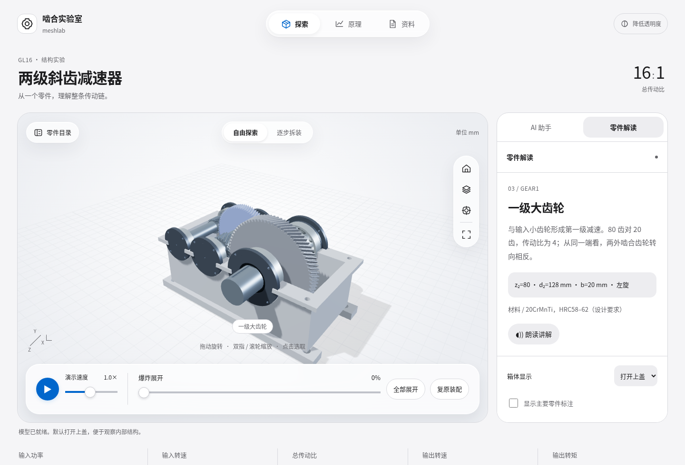
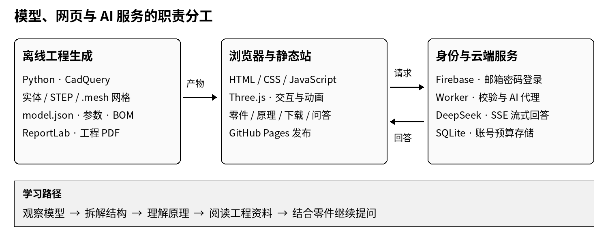

# 啮合实验室 meshlab
## 项目说明书

第一版 · V1.0

把机械原理，变成直觉。



面向机械学习与课程设计的 Web 三维交互教学平台

项目账号：Slack-ZH

编制日期：2026 年 11 月 12 日

项目网址：https://slack-zh.github.io/meshlab/

---

# 引言

面对一张减速器装配图，学习者需要在脑海中把齿轮、轴、轴承和箱体组合起来，再想象它们如何配合、如何运动。一个零件为什么放在这里？动力经过哪些环节传到输出端？拆下箱盖之后，下一步应该观察什么？这些问题连接着图纸上的符号与实际机械的工作过程。

啮合实验室 meshlab 从这一学习需求出发，希望让机械原理变得可以观察、可以拆解，也可以围绕具体零件继续提问。项目以 GL16 两级斜齿减速器为核心案例，把三维模型、装配关系、传动动画、工程资料和 AI 问答放到同一个网页环境中，为学习者提供连续的探索路径。

用户可以先转动模型、打开箱体，再选中零件阅读说明；可以沿着拆装步骤认识结构，也可以通过动画和公式理解转速与转矩的关系。当出现新的疑问时，用户能够结合当前所选零件向 AI 助手提问，并进一步阅读或下载设计资料。

项目的核心理念是“从一个零件，理解整条传动链”。三维交互负责建立空间认识，原理讲解帮助理解运动逻辑，工程资料提供进一步学习的依据，AI 问答则为持续追问提供入口。围绕同一案例组织这些能力，有助于减少学习者在不同工具和资料之间切换的负担。

本说明书介绍项目背景、需求与总体设计、核心功能、GL16 案例、技术实现、使用方式和已有成果，并简述商业应用价值与后续发展方向，供项目介绍、课程汇报和作品展示使用。内容依据公开网站、公开仓库和已记录的浏览器核对结果编写；现有实现与未来规划分别说明。

---

# 目录

- 引言
- 一、项目概述
- 二、需求分析与总体设计
- 三、核心功能介绍
- 四、GL16 减速器案例说明
- 五、技术架构与实现
- 六、使用说明
- 七、项目成果与特色
- 八、商业价值简述
- 九、现有局限与未来规划
- 十、附录与参考资料

---

# 一、项目概述

## 1.1 项目背景

机械原理与机械设计课程涉及空间结构、运动关系和工程计算。二维图纸能够清楚表达尺寸与技术要求，但对初学者而言，从图纸建立完整的空间认识需要一定训练。固定视角的视频便于演示过程，自主观察与按问题深入探索的空间则相对有限。

实体设备能够提供直接体验，但教学使用通常需要考虑设备数量、操作时间和场地条件。因此，在网页中提供可反复观察、可选择零件、可按步骤学习的典型机械案例，具有明确的教学应用意义。

## 1.2 项目定位

啮合实验室 meshlab 是面向机械学习与课程设计的 Web 三维交互教学平台。当前以 GL16 两级斜齿减速器为主要实验对象，围绕“观察—拆解—理解—提问”组织模型交互和教学内容。[1][2]

项目首页提供机械原理介绍与实验室入口；实验室承担三维探索、拆装演示、原理阅读、工程资料下载和 AI 问答等功能。用户通过支持 WebGL 的现代浏览器即可访问三维实验内容。

## 1.3 建设目标

- **建立空间认识：**帮助用户看清零件形态、装配位置和内部配合关系。
- **理解传动逻辑：**将输入、中间和输出轴的运动与传动比、转速和转矩公式关联起来。
- **连接课程设计：**提供同一案例的模型、图纸、参数和计算说明。
- **支持自主追问：**借助项目资料与所选零件上下文，为用户提供 AI 文字解答。

## 1.4 目标用户与当前范围

| 目标用户 | 主要使用需求 |
| --- | --- |
| 机械相关专业学生 | 结构认知、原理学习、课程设计参考 |
| 教师与助教 | 课堂演示、拆装讲解、问题讨论 |
| 机械初学者与爱好者 | 自主探索、建立机械直觉 |

首页包含齿轮传动、带传动、曲柄滑块、行星齿轮和齿轮齿条五类原理示意卡片；当前完整可交互的模型为 GL16，共有 49 个零件实例。[3]

---

# 二、需求分析与总体设计

## 2.1 核心需求

| 学习或使用问题 | 对应需求 | 项目设计回应 |
| --- | --- | --- |
| 内部结构不易直接观察 | 自主选择视角与显示方式 | 旋转、缩放、箱体显示切换 |
| 不清楚零件作用 | 结构位置与说明相互对应 | 点击选取、高亮、零件解读 |
| 难以理解装配层级 | 按整体和步骤观察结构 | 爆炸展开、七步拆装 |
| 动画与公式难以关联 | 在同一案例中解释参数 | 传动演示、原理页、转速关系 |
| 资料分散，追问不便 | 集中获取资料与解答 | 工程下载、AI 上下文问答 |

## 2.2 网站结构

项目由首页和三维实验室两部分构成。首页介绍理念、机械档案和上手方式，帮助用户理解平台用途。实验室以模型为操作中心，通过“探索”“原理”“资料”等入口组织内容，并在模型附近设置 AI 助手和零件解读面板。

该结构使三维观察、知识解释与工程资料保持相近的访问路径。用户能够根据当前问题切换内容，而不必先完成一条固定的学习课程。

## 2.3 功能模块划分

- **展示与导航模块：**项目介绍、原理档案、页面入口与移动端布局。
- **三维实验模块：**模型加载、视角控制、选取、播放、展开和拆装。
- **教学内容模块：**零件说明、材料规格、传动关系和基础公式。
- **工程资料模块：**STEP、PDF、CSV 和 JSON 等成果文件下载。
- **账号与 AI 模块：**登录、项目上下文问答、预算展示与服务端控制。

## 2.4 典型学习流程

进入实验室 → 选择零件 → 观察形态与装配 → 拆解或播放传动 → 阅读原理 → 提问或下载资料。

这一流程既支持带着问题自主探索，也适合教师围绕同一案例进行顺序讲解。前端交互、工程参数与 AI 上下文尽量共用项目数据，便于保持讲解与展示的一致性。

---

# 三、核心功能介绍

## 3.1 三维交互与零件解读

用户可拖动旋转、滚轮或双指缩放、点击选取，并切换默认视角、俯视、沿轴观察和全屏显示。零件目录支持名称或规格搜索，以及传动、箱体等范围筛选。选中零件后，模型高亮对应部件，解读面板展示名称、作用、规格与材料。

箱体支持打开上盖、透明、完整和隐藏等显示方式，并可打开主要零件标注。零件文字讲解支持浏览器语音朗读，中文语音的可用性取决于设备环境。[4]

## 3.2 爆炸展开与逐步拆装

自由探索模式提供 0%—100% 的爆炸展开滑块，以及全部展开和复原操作。逐步拆装模式从停机准备开始，按七个步骤认识装配层级，也可反向查看装配过程。

| 步骤 | 演示内容 | 观察重点 |
| --- | --- | --- |
| 01 | 松开合箱螺栓 | 紧固与解除连接 |
| 02 | 打开上箱盖 | 内部结构的显露 |
| 03 | 拆下端盖与油封 | 轴端定位和密封 |
| 04 | 分离轴承 | 轴与支撑件的关系 |
| 05 | 移出三根轴系 | 三根轴系的空间位置 |
| 06 | 拆分齿轮与平键 | 连接方式与转矩传递 |
| 07 | 认识箱体与全套零件 | 整体装配关系 |

展开或进入拆装时暂停传动；从展开状态播放时先复原装配，使结构状态与演示操作保持一致。

## 3.3 传动演示与原理讲解

动画保持三轴真实的转速比例，采用慢放方便观察，并支持播放、暂停和演示速度调节。原理页解释传动比、斜齿轮几何与转矩估算；输入转速控件用于探索中间轴和输出轴的转速变化。

## 3.4 工程资料与 AI 问答

用户可以下载装配模型、主要零件资料、图纸、设计说明、零件清单与参数文件。登录后，AI 助手结合 GL16 资料和当前所选零件进行文字问答，支持连续追问、停止、重试和新建对话。[2][7]

---

# 四、GL16 减速器案例说明

## 4.1 结构组成与动力路径

GL16 为两级斜齿减速器课程设计案例，主要由输入齿轮轴、中间齿轮轴、输出轴、大齿轮、轴承、平键、箱体、端盖、密封及紧固件组成。动力从输入齿轮轴进入，经一级大齿轮传至中间轴，再由二级小齿轮驱动输出大齿轮，最终通过输出轴传出。

一次外啮合改变转向，两次外啮合后输入轴与输出轴同向。同轴的一级大齿轮与二级小齿轮具有相同角速度。

## 4.2 主要设计参数

| 参数 | 设计值 | 说明 |
| --- | --- | --- |
| 输入功率 | 1.5 kW | 课程设计工况 |
| 输入 / 中间 / 输出转速 | 1,440 / 360 / 90 r/min | 按两级传动比确定 |
| 一级 / 二级传动比 | 4 / 4 | 两级均为 20 齿驱动 80 齿 |
| 总传动比 | 16∶1 | 两级传动比的乘积 |
| 总效率 | 0.96 | 转矩计算中的估算假设 |
| 输出转矩 | 约 152.8 N·m | 按功率、效率和输出转速估算 |
| 一级 / 二级中心距 | 80 / 112 mm | 对应设计几何参数 |
| 一级 / 二级法向模数 | 1.5 / 2 mm | 斜齿轮几何参数 |
| 一级 / 二级螺旋角 | 约 20.36° / 26.77° | 每对齿轮采用相反旋向 |

上述数据来自项目公开设计参数与原理页面。[2][5]

## 4.3 基本计算关系

总传动比：i = (z₂ / z₁) × (z₄ / z₃) = (80 / 20) × (80 / 20) = 16。

转速关系：n中间 = n输入 / 4，n输出 = n输入 / 16；三轴角速度比例为 1∶−1/4∶1/16。

转矩关系：T = 9550P / n，其中 P 为 kW，n 为 r/min，T 为 N·m。输出转矩约为 9550 × 1.5 × 0.96 / 90 = 152.8 N·m。

斜齿轮分度圆直径：d = mₙz / cosβ；中心距：a = mₙ(z₁ + z₂) / (2cosβ)。

## 4.4 动画与设计工况

网页以输入轴约 12 r/min 的基础速度慢放，可按 0.1×—2.0× 调节。页面标注的 1,440 r/min 属于设计工况；原理页的转速探索不会改写下载资料中的设计值。

---

# 五、技术架构与实现

## 5.1 整体架构



前端负责三维展示与交互，工程脚本生成模型和配套资料，云端负责账号校验、AI 调用和预算管理。静态网站由 GitHub Pages 承载，AI 服务独立部署于 Cloudflare Workers。[6][7]

| 技术层次 | 主要组件 | 实现职责 |
| --- | --- | --- |
| 页面与三维 | HTML、CSS、JavaScript、Three.js | 布局、网格渲染、选取和动画 |
| 工程生成 | Python、CadQuery、ReportLab | 实体建模、网格、STEP 和 PDF |
| 账号认证 | Firebase Authentication、jose | 邮箱密码登录与 ID token 校验 |
| AI 与存储 | Worker、DeepSeek、Durable Objects SQLite | 流式问答、预算预留与结算 |
| 发布维护 | GitHub Actions、Wrangler | 静态站发布与云端服务部署 |

## 5.2 模型与数据组织

建模脚本生成实体零件、STEP、二进制 .mesh 网格及 model.json。前端把网格转换为 Three.js BufferGeometry；零件元数据同时记录名称、分类、装配位置、爆炸位移、拆装阶段、说明、规格与转动比例，为交互和问答提供共同依据。[4][8]

## 5.3 AI 服务与账号预算

前端携带账号凭证和 selectedPartId 请求 Worker，服务端校验身份、补充项目与零件上下文，经预算预留后调用 DeepSeek，并通过 SSE 返回文字。当前属于项目资料上下文问答，尚未配置独立向量知识库检索模块。[9]

每账号每日应用预算为 2 元，北京时间零点重置；预算记录按账号持久化，先预留再结算。当前配置支持每账号每分钟最多 12 次、同时最多 2 次请求，单次最大输出 2,048 token。DeepSeek 密钥保存在服务端；实际费用由维护者承担。停止或用量不完整时可能保留预留额，页面占用与供应商账单可能不同。[7]

---

# 六、使用说明

## 6.1 访问与基本操作

打开项目首页，点击“开始探索”进入实验室。浏览器需要支持 WebGL；三维视图无法启动时，可继续通过资料入口获取模型和图纸。网页适配桌面与移动端，用户可按设备条件选择鼠标或触摸操作。

| 操作任务 | 使用方式 |
| --- | --- |
| 查看整体结构 | 拖动旋转，滚轮或双指缩放 |
| 了解指定零件 | 点击模型，或在零件目录搜索后选择 |
| 观察内部结构 | 切换打开上盖、透明或隐藏箱体 |
| 查看装配关系 | 拖动爆炸滑块，或点击全部展开 |
| 学习拆装顺序 | 切换逐步拆装，按上一步 / 下一步推进 |
| 理解动力传递 | 复原装配，播放传动并阅读原理页 |
| 深入学习 | 登录 AI 提问，或前往资料页下载 |

## 6.2 AI 助手使用

通过邮箱密码注册或登录后，选中目标零件再发送问题。可使用“这个零件在传动中起什么作用？”“为什么总传动比是 16？”等问题开始，并继续追问。Enter 发送，Shift+Enter 换行；生成过程中可停止，失败后可重试。

对话保存在当前页面内存中，刷新、退出或切换账号后会清空。当前仓库配置关闭强制邮箱验证，实际登录要求以已部署服务为准。当前 AI 提供文字解答，模型操作仍通过页面控件完成。[7][9]

## 6.3 工程资料下载

资料页提供完整 ZIP 工程包、GL16-assembly.step 装配模型、GL16-drawings.pdf 图纸、GL16-design-report.pdf 课程设计说明、parts-list.csv 零件清单和 design-parameters.json 设计参数。

其中，课程设计说明针对 GL16 的机械设计过程，本说明书介绍整个 meshlab 软件项目。下载后可结合相应 CAD 或文档软件进一步阅读与复核。

## 6.4 本地预览与发布

维护者在仓库 meshlab 目录内，使用 Node.js 22+ 执行以下命令，默认访问 http://127.0.0.1:8080 。本地 /api 使用配置的云端代理，仍受账号和预算规则约束。[7]

```bash
node --env-file-if-exists=.env server/local.mjs
```

静态网页由 GitHub Actions 发布 meshlab/dist；AI 服务通过 Wrangler 部署，需配置认证、允许访问的网站来源与服务端密钥。

---

# 七、项目成果与特色

## 7.1 已形成的成果

项目已提供可访问的网站首页与三维实验室、GL16 的 49 个零件实例及交互数据，以及装配 STEP、主要零件资料、工程图、课程设计说明、零件清单和设计参数。公开仓库包含模型生成、文档生成、前端交互、AI 服务及验证脚本。

AI 模块已实现邮箱密码登录、项目上下文文字问答、流式展示与账号预算控制。自然语言直接操作模型和工程仿真仍属于后续规划。[7][10]

## 7.2 本次浏览器核对

| 核对项目 | 记录结果 |
| --- | --- |
| 网站与模型访问 | 首页及实验室可打开，三维模型就绪 |
| 零件数量 | 程序状态返回 partCount = 49 |
| 全部展开 | 状态返回 explodeTarget = 1 |
| 拆装推进 | 七步推进后显示 07 / 07 |
| 转速关系 | 输入 800 r/min 时，输出显示 50 r/min |
| 界面留档 | 已保存装配、展开与原理页面截图 |

以上记录来自 2026 年 11 月 12 日对公开网站的功能抽查。仓库另有布局、账号预算和聊天模拟等历史验证记录，本次未全部重新执行；未注册真实账号或发起付费 AI 问答。[11]

## 7.3 项目特色

**围绕同一案例组织学习。** 零件、动画、公式和工程资料相互关联，使用户可以沿着自己的问题逐步深入。

**将三维交互与解释结合。** 用户既能观察结构，也能查看材料、规格与作用，再通过 AI 继续追问。

**通过共同数据保持内容联系。** 模型元数据同时参与结构展示、零件解读与问答上下文，便于随项目版本维护。

**采用网页访问方式。** 三维实验适合用于课堂展示、远程访问和个人复习，减少教学前安装专用查看工具的环节。

这些特点体现了项目的教学辅助价值。当前尚无公开的学习效果对照研究或用户规模数据，后续可通过试用反馈与教学验证进一步评估。

---

# 八、商业价值简述

## 8.1 价值定位

项目的商业应用潜力主要来自“把复杂机械内容转化为可访问、可交互、可持续提问的学习资源”。对于教学与培训机构，其价值在于提供结构演示和自主学习工具；对于设备或工程内容提供方，其价值在于把已有模型与技术资料转化为更容易理解的网页展示内容。

以完整案例组织模型、原理与资料，能够形成可交付的教学内容单元。若后续扩展为多个经过审核的机械案例，项目可从单一作品发展为按课程、设备类别或培训主题组织的内容产品。

## 8.2 潜在客户与应用方向

| 潜在对象 | 应用需求 | 可探索的交付方式 |
| --- | --- | --- |
| 高校、职业院校 | 机械课程演示与辅助实验 | 教学资源包、机构服务 |
| 工程培训机构 | 结构认知与设备培训 | 主题案例、培训平台定制 |
| 设备制造与技术服务企业 | 产品结构说明与客户培训 | 网页演示、专属模型定制 |
| 科普与线上教育平台 | 易理解的机械互动内容 | 内容合作、嵌入式展示 |

## 8.3 商业化方式与成本考虑

可优先探索面向机构的模型与教学内容定制服务，再根据内容成熟度评估机构授权、持续维护或订阅服务。定制交付能够围绕明确设备、用户和课程目标开展验证；形成重复需求后，再沉淀可复用的模型、内容模板和平台能力。

报价与运营需要考虑模型制作、工程资料整理、教学内容审核、浏览器适配、平台维护和 AI 调用成本。当前每日 2 元的账号预算属于 AI 服务使用控制，并非产品售价，商业收费应另行设计。

## 8.4 推进建议

建议先选择一门课程或一个培训主题开展试用，记录教师和学习者的实际操作、常见问题及内容需求，再评估机构付费意愿和维护投入。近期可用“是否便于讲解、是否便于自主探索、是否减少重复答疑”作为访谈重点。

本节提出的是基于现有能力的商业方向判断。现有资料未提供营收、付费客户或市场规模数据，商业可行性仍需结合实际试用和成本测算验证。

---

# 九、现有局限与未来规划

## 9.1 当前适用范围

当前完整实验案例集中于 GL16，首页其他机械档案属于原理示意，尚未形成完整的多模型实验库。教学内容和 AI 上下文也以这一案例为主。

GL16 为参考 ZLY 工业结构的独立课程设计。模型简化了螺纹、轴承滚道、油封唇口和齿根过渡；工程资料提供设计表达与初步校核。若用于制造或工程验算，仍需补充适用的工艺、公差链、强度和寿命验证。[2][5]

三维动画依据设定的运动关系播放，当前未接入动力学、应力或碰撞求解。AI 目前提供文字说明，不能直接执行模型操作或代替确定性的工程计算。

## 9.2 近期：自然语言控制现有模型

可先围绕已有操作支持有限指令，例如选择零件、切换视角、展开复原、播放暂停和切换拆装步骤。AI 生成结构化动作，由程序校验动作名称、零件编号与参数范围后执行，并提供清楚的结果反馈与复原入口。[10]

## 9.3 中期：教学过程与内容扩展

将零件高亮、视角变化、文字讲解与播放组合为可暂停、可重播的教学步骤，先完成固定模板，再逐步扩展。根据课程与试用需求增加齿轮、带传动或其他典型机械案例，并为每个案例补充配套资料。

## 9.4 后期：计算工具与工程仿真

优先接入传动比、转速和转矩等可复算的确定性计算工具，由 AI 收集输入并解释结果。再依据具体需求选择仿真引擎，明确材料、载荷、边界条件、单位及结果适用范围。[10]

## 9.5 阶段验收建议

| 阶段 | 重点验收内容 |
| --- | --- |
| 模型控制 | 指令与动作一致、参数有效、状态可复原 |
| 分步教学 | 讲解、高亮与动画同步，支持暂停和重播 |
| 多模型扩展 | 目录、交互、参数与资料完整对应 |
| 计算与仿真 | 输入明确、结果可复算、适用范围清楚 |

后续安排应结合开发维护资源、教学反馈和商业试用结果确定。

---

# 十、附录与参考资料

## 10.1 项目地址与主要目录

项目网站：https://slack-zh.github.io/meshlab/

公开仓库：https://github.com/Slack-ZH/meshlab

主要目录：meshlab/dist 为网页与资源；meshlab/server 为 AI、认证与预算服务；meshlab/scripts 为生成和验证脚本；meshlab/docs 为说明与记录；.github/workflows 为发布配置。

## 10.2 常用术语

STEP：工程三维模型交换格式。BOM：零件与材料清单。WebGL：浏览器三维图形接口。SSE：服务端向浏览器持续推送内容的流式通信方式。ID token：用于服务端验证登录身份的凭证。

## 10.3 参考资料

以下仓库文件对应核对版本 88aa7e4e85ae77475229baf2b3a262532e9e7cc1。网站与代码核对日期为 2026 年 11 月 12 日。

[1] 项目首页：定位、介绍与学习路径。
https://slack-zh.github.io/meshlab/

[2] 三维实验室：功能、原理、下载与设计范围。
https://slack-zh.github.io/meshlab/lab.html

[3] 首页与实验室说明：模型范围与历史验证。
https://github.com/Slack-ZH/meshlab/blob/88aa7e4/meshlab/HOMEPAGE.md

[4] 三维交互实现：dist/app.js。
https://github.com/Slack-ZH/meshlab/blob/88aa7e4/meshlab/dist/app.js

[5] GL16 设计参数。
https://slack-zh.github.io/meshlab/downloads/design-parameters.json

[6] 静态站发布工作流。
https://github.com/Slack-ZH/meshlab/blob/88aa7e4/.github/workflows/pages.yml

[7] AI 接入、账号预算与部署说明。
https://github.com/Slack-ZH/meshlab/blob/88aa7e4/meshlab/docs/AI-SETUP.md

[8] 参数化建模脚本。
https://github.com/Slack-ZH/meshlab/blob/88aa7e4/meshlab/scripts/build_model.py

[9] AI 服务与验证策略配置：server/chat-api.mjs、wrangler.jsonc。
https://github.com/Slack-ZH/meshlab/tree/88aa7e4/meshlab/server

[10] AI 功能路线图。
https://github.com/Slack-ZH/meshlab/blob/88aa7e4/meshlab/docs/AI-ROADMAP.md

[11] 历史界面验证记录。
https://github.com/Slack-ZH/meshlab/blob/88aa7e4/meshlab/docs/verification.json
